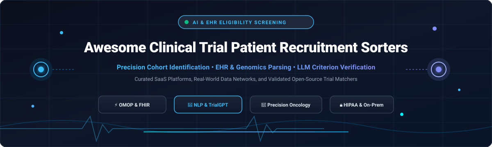

# Awesome Clinical Trial Patient Recruitment Sorters [](https://awesome.re)

<p align="center">
  
</p>

<p align="center">
  <a href="https://github.com/ishandutta2007/Awesome-Awesome-Awesome"></a>
  <a href="https://discord.gg/jc4xtF58Ve"></a>
  
  
  
  
  <a href="https://github.com/ishandutta2007"></a>
</p>

> 🧬 A curated list of **SaaS platforms** and **open-source AI/NLP projects** for **Clinical Trial Patient Recruitment Sorters**, EHR pre-screening, eligibility criterion matching, and precision cohort identification.

---

## 📖 Table of Contents

- [🔍 Sector Overview & Market Dynamics](#-sector-overview--market-dynamics)
- [💼 SaaS & Hosted Platforms](#-saas--hosted-platforms)
- [💻 Open-Source GitHub Projects](#-open-source-github-projects)
- [🏗️ Key Architectural Approaches](#️-key-architectural-approaches)
- [🤝 How to Contribute](#-how-to-contribute)
- [💖 Support & Sponsorship](#-support--sponsorship)
- [⭐ Star History](#-star-history)
- [⚖️ Disclaimer & Regulatory Considerations](#️-disclaimer--regulatory-considerations)

---

## 🔍 Sector Overview & Market Dynamics

The global **Clinical Trial Patient Recruitment Market** is estimated at **$11.7B to $13.2B in 2025–2026** (projected to reach over $22B–$26B by 2033 at an 8.5% CAGR), while the specialized **AI-driven patient recruitment and EHR-matching software sub-segment** accounts for approximately **$720M to $1.14B** and is growing rapidly at >20% CAGR.

The sector exhibits a **hybrid market dynamic—moderately concentrated at the top full-service CRO layer, yet highly fragmented across specialized technology, EHR matching, and recruitment vendors**:
- 🏢 **Concentrated Top Tier:** Mega-CROs and global healthcare analytics incumbents (such as IQVIA, ICON plc, Parexel, Labcorp Drug Development, and Syneos Health) control significant shares of outsourced clinical trial development budgets, frequently bundling recruitment within enterprise master service agreements.
- 🧩 **Fragmented AI & Digital Sorter Ecosystem:** The specialized patient recruitment software and AI matcher space is non-monopolistic and fragmented. Category innovators, digital networks (Trialbee, Paradigm, Antidote, Inato), and dedicated EHR AI engines (Deep 6 AI / Tempus AI, Reify Health) compete alongside academic open-source frameworks without a single winner-take-all outcome, driven by diverse hospital EHR systems, localized clinical networks, and protocol complexities.

---

## 💼 SaaS & Hosted Platforms

Below is an overview of leading SaaS platforms and hosted networks specializing in clinical trial patient recruitment, trial-site matching, and real-world EHR screening. The table includes company scale (valuation or annual revenue), transparent starting pricing tiers, and specific free tier / trial terms.

*Sorted by Company Scale / Valuation (Descending)*

| Platform | Company Scale (Valuation / Revenue) | Starting Pricing Tier | Free Tier Limits / Free Trial Terms | Key Capabilities & Differentiators |
| :--- | :--- | :--- | :--- | :--- |
| **[Reify Health](https://www.reifyhealth.com/)** | **$4.8B Valuation** (Series D; ~$189M ARR) | **Free for research sites**; Enterprise sponsor contracts start at **~$50,000/study** | **Free forever for clinical research sites** (full access to StudyTeam patient screening workflow); No free trial for pharma sponsors (custom pilot POC available on request) | Two-sided trial infrastructure: StudyTeam provides site workflow automation and patient logging, while Care Access powers decentralized screening and diversity recruitment. |
| **[TriNetX](https://www.trinetx.com/)** | **>$1.5B Valuation** (Carlyle majority acquisition; est. >$150M ARR) | Free institutional tier; Commercial pharma subscription starts at **~$20,000/year** (basic access) up to multi-hundred-thousand enterprise packages | **Free forever for affiliated researchers** at 200+ member academic healthcare organizations (unlimited cohort count queries; zero row-level PHI export); 100-patient sample data extract free on AWS Data Exchange | Federated global health research network spanning 200+ health centers across 30+ countries. Enables real-time feasibility queries and EHR cohort screening. |
| **[Paradigm](https://paradigmhealth.com/)** | **~$350M–$500M Est. Valuation** ($203M funding; ~$30M ARR) | Software-enabled site deployment starts at **~$35,000/trial** for sponsor protocol integration | **Free forever for participating health network community clinics and investigators** (EHR connector and coordinator tool); No self-serve trial for commercial biopharma | Re-engineered oncology and rare disease trial network; acquired Flatiron Health's Clinical Research Business to embed automated trial matching across top community oncology practices. |
| **[Deep 6 AI](https://deep6.ai/)** | **~$150M–$200M Est. Valuation** (Acquired by Tempus AI; ~$12M ARR) | Enterprise hospital deployment starts at **~$60,000/year** per hospital site; Sponsor study query packages start at **~$25,000/protocol** | **30-day proof-of-concept (POC) trial** on a single retrospective disease cohort (up to 5,000 patient records parsed); No free tier for production use | Precision matching engine extracting structured and unstructured EHR data (physician notes, pathology, genomics) in minutes using clinical NLP. |
| **[Antidote](https://www.antidote.me/)** | **~$92M Valuation** (Series B; est. ~$8M ARR) | Performance-based / Cost-per-screened-lead starting at **~$25 to ~$75 per validated pre-screener lead**; Campaign setups start at **~$10,000/study** | **Free forever for patients** (unlimited trial search and pre-screening matching); Free 1-month trial feasibility query assessment (up to 1 clinical protocol review) for sponsors | Consumer-friendly digital trial matching platform connecting patients with sponsors via interactive pre-screening questionnaires and site referrals. |
| **[Inato](https://inato.com/)** | **~$70M–$100M Valuation** ($35.5M funding; est. ~$5M ARR) | Site network access plans start at **~$15,000/study** for site feasibility scoring | **Free forever for community clinical sites** (unlimited protocol access, site profile registration, and feasibility matching); Sponsors can request 1 complimentary study site-feasibility analysis | Community-site marketplace reversing trial centralization by qualifying community research clinics and underrepresented patient populations. |
| **[AutoCruitment](https://autocruitment.com/)** | **~$60M–$80M Est. Valuation** (Acquired by QHP Capital; ~$30M ARR) | Targeted digital recruitment campaigns start at **~$15,000/wave** (performance-based cost-per-randomized participant models available) | **No free tier**; Offers a complimentary study protocol pre-feasibility analysis and recruitment timeline projection report (limited to 1 protocol) | Direct-to-patient digital recruitment using machine learning targeting algorithms and pre-screening workflows across 100+ conditions. |
| **[SubjectWell](https://subjectwell.com/)** | **~$50M–$75M Est. Valuation** ($47M funding; est. ~$25M ARR) | Risk-free, performance-only model: **$0 upfront platform fee**, pay-per-randomized-patient starting at **~$1,500 to ~$4,500 per randomized patient** depending on indication | **Free forever for patient registrants**; Zero upfront financial risk for trial sponsors (charges incur only upon successful patient randomization at site) | Risk-free clinical trial patient marketplace recruiting from a persistent pre-screened pool of millions of registered candidates. |
| **[Clara Health](https://www.clarahealth.com/)** | **~$10M Valuation** (Acquired by Neighborhood Trials; est. ~$2M ARR) | Protocol onboarding and study portal configuration starting at **~$8,000/trial** | **Free forever for patients and patient advocacy groups** (unlimited search, navigation assistance, and clinical team communication); No self-serve trial for commercial sponsors | Patient-centric platform guiding patients and caregivers through clinical trial navigation, site scheduling, and protocol comprehension. |
| **[John Snow Labs (Trial Matching NLP)](https://www.johnsnowlabs.com/clinical-trial-matching/)** | **Bootstrap / Profitable** (Est. ~$20M ARR; Enterprise Life Sciences) | Hourly AWS Marketplace software fee from **~$3.00/hour** (EC2 AMI); Dedicated Healthcare NLP server license starts at **$8,000/month** | **30-day free trial on AWS Marketplace** (limited to 1 concurrent cloud virtual machine instance; cloud infrastructure costs billed separately); Apache 2.0 open-source Spark NLP library free forever | Healthcare NLP and Medical LLMs running air-gapped on-premises or private cloud; maps OMOP CDM cohorts with zero patient data leaving institution firewalls. |

---

## 💻 Open-Source GitHub Projects

Open-source clinical trial matching repositories enable academic medical centers, health systems, and data scientists to build transparent, self-hosted, and verifiable recruitment workflows.

*Sorted by GitHub Stars_Count (Descending)*

| Repository | GitHub_Stars | Primary Language / Stack | Core Focus & Matching Architecture |
| :--- | :--- | :--- | :--- |
| **[OpenClinica](https://github.com/OpenClinica/OpenClinica)** | [](https://github.com/OpenClinica/OpenClinica/stargazers) | Java, JavaScript | Electronic Data Capture (EDC) and Clinical Data Management (CDM) platform with integrated subject screening, eligibility validation, and eConsent workflows. |
| **[facebookresearch/Clinical-Trial-Parser](https://github.com/facebookresearch/Clinical-Trial-Parser)** | [](https://github.com/facebookresearch/Clinical-Trial-Parser/stargazers) | Python | Rule-based and deep-learning NLP parser converting unstructured clinical trial eligibility criteria into standardized, machine-readable semantic representations. |
| **[ncbi-nlp/TrialGPT](https://github.com/ncbi-nlp/TrialGPT)** | [](https://github.com/ncbi-nlp/TrialGPT/stargazers) | Python | NIH/NCBI LLM framework featuring TrialGPT-Retrieval, TrialGPT-Matching (87.3% criterion accuracy with rationales), and TrialGPT-Ranking (reduces clinician screening time by 42.6%). |
| **[reliatec-gmbh/LibreClinica](https://github.com/reliatec-gmbh/LibreClinica)** | [](https://github.com/reliatec-gmbh/LibreClinica/stargazers) | Java, JSP, Docker | Community-maintained open-source EDC/CDMS platform supporting clinical trial subject recruitment logs, rule-driven validation checks, and CDISC ODM standards. |
| **[dfci/matchminer](https://github.com/dfci/matchminer)** | [](https://github.com/dfci/matchminer/stargazers) | Python, MongoDB | Dana-Farber Cancer Institute computational engine matching precision cancer genomic variants and clinical profiles to Phase I–III precision oncology trials. Validated across 400+ enrollments. |
| **[Tian312/PICO_Parser](https://github.com/Tian312/PICO_Parser)** | [](https://github.com/Tian312/PICO_Parser/stargazers) | Python, PyTorch | Clinical BERT-based NLP tool for segmenting clinical trial protocols into Population, Intervention, Comparison, and Outcome (PICO) entities for automated cohort alignment. |
| **[dfci/matchengine-V2](https://github.com/dfci/matchengine-V2)** | [](https://github.com/dfci/matchengine-V2/stargazers) | Python, PyMongo | Next-generation genomic and clinical matching engine from Dana-Farber, supporting complex boolean criteria, wildcards, and continuous clinical trial updates. |
| **[cbib/TrialMatchAI](https://github.com/cbib/TrialMatchAI)** | [](https://github.com/cbib/TrialMatchAI/stargazers) | Python, LangChain | LLM-driven clinical trial matching engine assessing patient summaries against inclusion/exclusion criteria to output ranked trial suitability scores. |
| **[healthkey-ai/promop](https://github.com/healthkey-ai/promop)** | [](https://github.com/healthkey-ai/promop/stargazers) | Python, Django, PostgreSQL | High-performance OMOP CDM oncology extension creating denormalized tables for sub-second cohort discovery, trial eligibility screening, and clinical decision support. |
| **[adityashukla8/clinicaltrials-multiagent](https://github.com/adityashukla8/clinicaltrials-multiagent)** | [](https://github.com/adityashukla8/clinicaltrials-multiagent/stargazers) | Python, Multi-Agent LLMs | Multi-agent AI system for clinical trial protocol matching, synthetic patient verification, and automated inclusion/exclusion eligibility reasoning. |
| **[mcode/clinical-trial-matching-engine](https://github.com/mcode/clinical-trial-matching-engine)** | [](https://github.com/mcode/clinical-trial-matching-engine/stargazers) | TypeScript, Node.js | HL7 FHIR-compliant wrapper engine translating mCODE (minimal Common Oncology Data Elements) patient records into queries for trial-matching services. |
| **[stanford-oval/clinical-trial-matching](https://github.com/stanford-oval/clinical-trial-matching)** | [](https://github.com/stanford-oval/clinical-trial-matching/stargazers) | Python, SQL, Z3 | Stanford OVAL & Mayo Clinic matching system pairing SatIR (pure SQL high-recall retrieval) with VERDICT (accountable LLM/MaxSAT eligibility decisions, F1 0.828). |
| **[RyanWangZf/PyTrial](https://github.com/RyanWangZf/PyTrial)** | [](https://github.com/RyanWangZf/PyTrial/stargazers) | Python, PyTorch | Comprehensive AI for drug development package with dedicated patient-to-trial eligibility matching, trial similarity search, and outcome simulation. |
| **[pughlab/ctims](https://github.com/pughlab/ctims)** | [](https://github.com/pughlab/ctims/stargazers) | TypeScript, NestJS, Docker | Clinical Trial Integrated Matching System (Princess Margaret, DFCI, MSKCC) integrating cBioPortal and a visual CTML trial-curation editor. |
| **[AveraSD/CancerTrialMatch](https://github.com/AveraSD/CancerTrialMatch)** | [](https://github.com/AveraSD/CancerTrialMatch/stargazers) | R, Shiny, MongoDB | Precision oncology matching application integrating the ClinicalTrials.gov API and OncoTree disease classifications for institutional trial portfolios. |

---

## 🏗️ Key Architectural Approaches

Modern patient recruitment sorters typically adopt a hybrid pipeline combining structured data filtering with deep semantic reasoning:

```
[Electronic Health Records (EHR / FHIR / OMOP)]
                        │
       ┌────────────────┴────────────────┐
       ▼                                 ▼
[Structured SQL Filter]          [Unstructured Clinical Notes]
 • Lab thresholds, Age, Stage      • Prior therapies, Histology, Performance status
 • ICD-10, RxNorm, SNOMED-CT       • Clinical NLP / BioBERT / Medical LLM Extraction
       │                                 │
       └────────────────┬────────────────┘
                        ▼
         [Trial Retrieval & Candidate Ranker]
           • SatIR / FAISS Vector Search / BM25
                        ▼
         [Criterion-Level Reasoning & Verification]
           • TrialGPT / VERDICT MaxSAT / Rule Engines
                        ▼
         [Clinician Review & Coordinator Dashboard]
           • Explanation rationales, human consent & contact
```

1. ⚡ **Two-Stage Retrieval & Screening:** First-stage fast retrieval filters millions of records down to a candidate cohort using SQL/OMOP indices; second-stage deep LLM reasoning evaluates granular inclusion/exclusion criteria.
2. 🎯 **Explainability & Grounding:** Systems like NIH TrialGPT and Stanford VERDICT provide verbatim sentence-level source attributions to eliminate hallucination risks in clinical decision support.
3. 🔐 **On-Premise / Air-Gapped Deployment:** Due to HIPAA and GDPR restrictions, solutions commonly utilize local models (Llama-3, Qwen-2.5-Medical, Spark NLP) or zero-data-retention HIPAA BAA cloud endpoints.

---

## 🤝 How to Contribute

We welcome community contributions from clinical researchers, data scientists, and healthcare software engineers!

1. 🍴 **Fork the repository** on GitHub.
2. 📝 **Add or update an entry** in [README.md](file:///C:/Users/ishan/Documents/Projects/Awesome-Clinical-Trial-Patient-Recruitment-Sorters/README.md). Ensure:
   - SaaS platforms include transparent pricing details, company scale metrics, and exact free tier/trial limitations.
   - Open-source projects include official GitHub links, social Stars_Badge (`style=social&color=white`), and factual architecture details.
3. 🚀 **Submit a Pull Request** with a clear explanation of changes.

---

## 💖 Support & Sponsorship

Thank you so much for exploring and supporting **Awesome Clinical Trial Patient Recruitment Sorters**! 🌟

If you found this curated list helpful for your research, site workflows, clinical data platform, or open-source projects, please consider:
- ⭐ **Starring this repository** to help others discover it.
- 🍴 **Forking and sharing** with clinical research coordinators, oncologists, biostatisticians, and health-tech teams.
- ☕ **Buying a coffee or sponsoring the maintainer** via the [GitHub Sponsors Dashboard](https://github.com/sponsors/ishandutta2007) to support ongoing curation and maintenance.

Your support helps keep open-source clinical trial matching tools active, transparent, and accessible to all!

---

## ⭐ Star History

[](https://star-history.dera.page/#ishandutta2007/Awesome-Clinical-Trial-Patient-Recruitment-Sorters&type=date&legend=top-left)

---

## ⚖️ Disclaimer & Regulatory Considerations

- ⚠️ **Informational Purposes Only:** This repository is an educational and community-curated list and does not constitute medical, legal, or commercial endorsement.
- 📋 **Regulatory Compliance:** Any software or pipeline processing patient health information (PHI) must strictly adhere to HIPAA, GDPR, 21 CFR Part 11, and institutional review board (IRB) protocols.
- 🩺 **Human Clinical Judgment:** Automated matchers and AI sorters serve as assistive prescreening tools. Final eligibility confirmation and consent must be conducted by qualified principal investigators and study coordinators.
